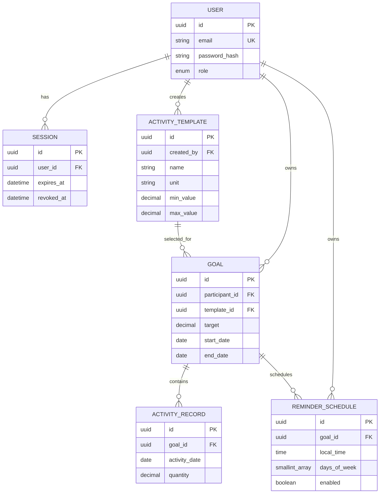

# System SDS — Sprint 1 baseline and Delivery 2 update

## 1. Architecture and responsibilities

The implementation is a web client, REST API, and relational database. The UI sends HTTPS JSON requests to the API. The API authenticates the session, authorizes by role and owner, validates input, runs domain calculations, and performs transactional database operations. The database owns persistence constraints such as foreign keys and the unique daily-record key; the API owns user-facing rule errors and progress formatting.

Implemented stack: Express 5 with TypeScript, `pg`, and `bcryptjs`; PostgreSQL; React with Vite; Jest with supertest for unit/API tests; and Playwright for E2E tests.

## 2. Entities, ownership, and constraints

| Entity | Key fields | Constraints / ownership |
|---|---|---|
| User | `id`, `email`, `password_hash`, `role`, `created_at` | Unique normalized email; role is `participant` or `program_manager`; password hash only. |
| Session | `id`, `user_id`, `expires_at`, `created_at`, `revoked_at` | Foreign key to User; expires and can be revoked at logout. |
| ActivityTemplate | `id`, `name`, `description`, `unit`, `min_value`, `max_value`, `is_active`, `created_by`, timestamps | Created/maintained by manager; `min_value <= max_value`; `unit` immutable in S1. |
| Goal | `id`, `participant_id`, `template_id`, `target`, `start_date`, `end_date`, `version`, timestamps | Participant-owned; target is positive period-total quantity; S2 revisions update the current version without deleting historical revisions. |
| GoalRevision | `id`, `goal_id`, `version_number`, `target`, `end_date`, `effective_date`, `created_at` | Goal-owned immutable version history; unique `(goal_id, version_number)`. |
| ActivityRecord | `id`, `goal_id`, `activity_date`, `quantity`, `created_at` | Goal-owned; quantity in inclusive template range; unique `(goal_id, activity_date)`; no overwrite. |
| ReminderSchedule | `id`, `goal_id`, `local_time`, `days_of_week`, `enabled`, `created_at`, `updated_at` | Goal-owned; one to seven unique ISO weekdays; maximum three rows per goal; no dispatcher/notification. |

### ER diagram



## 3. Setup, migrations, and seed data

Local setup uses `.env` from `.env.example`, installs dependencies, starts PostgreSQL, runs versioned migrations, then starts API and UI. Migrations create tables, enums, indexes, foreign keys, and the unique daily-record constraint; the explicit `npm run seed` command creates non-production manager, participant, and study-template data. Seed passwords are development-only and never used in deployed environments. CI is Lab 5 work and is not Sprint 1 evidence.

## 4. Screens and navigation

Routes: `/login`; `/participant` (participant goals, progress, history, streak, revisions, and reminders); `/manager` (manager catalog). Goal creation is embedded in the participant page. The top-level shell provides logout and current-user display. The Reminders section is a focused create/list UI only: it has no update, delete, enable/disable, or notification control.

All screens use shared loading, empty, validation-error, unauthorized, not-found, conflict, and retryable-server-error states. Forms validate client-side for usability, but the API repeats every rule. Empty states explain the next permitted action; no private data is rendered from a failed authorization response.

## 5. API conventions

JSON error shape:

```json
{
  "error": { "code": "DUPLICATE_DAILY_RECORD", "message": "A record already exists for this goal and date.", "details": {} }
}
```

Status codes: 200 read/update, 201 create, 204 logout, 400 validation, 401 missing/expired session, 403 authenticated but forbidden, 404 resource not found or intentionally hidden by privacy policy, 409 duplicate/conflicting state, 500 unexpected server error. Protected request checks occur in this order: **401 → 403 → 404 → 400 → 409**. The API does not reveal whether another participant's private resource exists.

| Method | Endpoint | Purpose |
|---|---|---|
| POST | `/api/auth/login` | Create session. |
| POST | `/api/auth/logout` | Revoke current session. |
| GET | `/api/me` | Current user and role. |
| POST | `/api/templates` (alias: `/api/activity-templates`) | Manager creates template. |
| GET | `/api/templates` (alias: `/api/activity-templates`) | Authenticated user lists active templates. |
| PATCH | `/api/templates/:id` (alias: `/api/activity-templates/:id`) | Manager updates allowed metadata; rejects `unit`. |
| POST | `/api/goals` | Participant creates goal. |
| GET | `/api/goals` | Participant lists own goals. |
| GET | `/api/goals/:id` | Participant retrieves own goal, summary, and permitted history. |
| POST | `/api/goals/:id/records` | Participant creates one daily record. |
| GET | `/api/goals/:id/records` | Participant lists own goal records. |
| GET | `/api/goals/:id/progress` | Participant receives computed progress. |
| GET | `/api/goals/:id/summary` | Participant receives owner-scoped progress, streak, records, and revisions. |
| GET | `/api/goals/:id/revisions` | Participant lists immutable goal revision history. |
| POST | `/api/goals/:id/revisions` | Participant creates an owner-scoped goal revision. |
| POST | `/api/goals/:id/reminder-schedules` | Participant creates one of at most three owner-scoped reminder schedules. |
| GET | `/api/goals/:id/reminder-schedules` | Participant lists schedules and read-time `next_occurrence_at`. |

## 6. Role/permission matrix for every Sprint 1 endpoint

`PM` = Program Manager, `P` = Participant, `Auth` = any authenticated user, `—` = not permitted.

| Endpoint | Anonymous | PM | P | Ownership/notes |
|---|---:|---:|---:|---|
| POST `/api/auth/login` | ✓ | ✓ | ✓ | Valid credentials only. |
| POST `/api/auth/logout` | 401 | ✓ | ✓ | Current session only. |
| GET `/api/me` | 401 | ✓ | ✓ | Current user only. |
| POST `/api/templates` | 401 | ✓ | 403 | Manager creates. |
| GET `/api/templates` | 401 | ✓ | ✓ | Active shared catalog; no private records. |
| PATCH `/api/templates/:id` | 401 | ✓ | 403 | Manager only; `unit` rejected for all roles. |
| POST `/api/goals` | 401 | 403 | ✓ | Goal owner is current participant. |
| GET `/api/goals` | 401 | 403 | ✓ | Own goals only. |
| GET `/api/goals/:id` | 401 | 403 `ROLE_FORBIDDEN` | owner ✓, other 404 | Managers have no private-goal access. |
| POST `/api/goals/:id/records` | 401 | 403 `ROLE_FORBIDDEN` | owner ✓, other 404 | Managers have no record-creation access. |
| GET `/api/goals/:id/records` | 401 | 403 `ROLE_FORBIDDEN` | owner ✓, other 404 | Managers have no private-history access. |
| GET `/api/goals/:id/progress` | 401 | 403 `ROLE_FORBIDDEN` | owner ✓, other 404 | Managers have no progress access. |
| GET `/api/goals/:id/summary` | 401 | 403 `ROLE_FORBIDDEN` | owner ✓, other 404 | Summary is owner-scoped. |
| GET `/api/goals/:id/revisions` | 401 | 403 `ROLE_FORBIDDEN` | owner ✓, other 404 | Revision history is owner-scoped. |
| POST `/api/goals/:id/revisions` | 401 | 403 `ROLE_FORBIDDEN` | owner ✓, other 404 | Records are not rewritten. |
| GET `/api/goals/:id/reminder-schedules` | 401 | 403 `ROLE_FORBIDDEN` | owner ✓, other 404 | No schedule existence leak. |
| POST `/api/goals/:id/reminder-schedules` | 401 | 403 `ROLE_FORBIDDEN` | owner ✓, other 404 | Payload/domain errors follow authorization checks. |

The automated matrix tests both cross-participant access and a participant attempting to edit a shared template. No role receives consent-based sharing in Sprint 1.

## Delivery 2 architecture, verification, and coverage gaps

Delivery 2 keeps the same web/API/database boundary and adds three owner-scoped capabilities. S2 goal revisions append a `goal_revisions` row and update the current goal version in one transaction; existing daily records are not rewritten. The S2 summary reads records and revisions, calculates capped progress and the current streak with an injected clock, and returns the owner's history. S3 reminder schedules are persisted in the additive `reminder_schedules` migration and calculate `next_occurrence_at` at read time; no notification dispatcher, queue, email, push, webhook, or provider integration exists.

| Area | Evidence and measured status | Gap / follow-up |
|---|---|---|
| S2 goal revision and summary | `goals.revision.test.ts`, `sprint2.history.test.ts`; Issue 6 evidence; API suite passed | No known open implementation gap in the recorded scope. |
| S2 performance | `docs/evidence/d2-s2/performance-benchmark.md`; 100,002 rows and p95 187.46 ms | Re-run on the final submission candidate if the release commit changes. |
| S3 reminders | `reminder-schedules.test.ts` 6/6; Issue 9 evidence and PR #120 | Manual UI evidence is captured; no notification delivery is in scope. |
| NFR-03 logging/credentials | bcrypt and session tests exist; plaintext-log inspection is not a complete automated check | Keep log inspection in final verification; never record passwords, cookies, or tokens. |
| NFR-06 coverage | Lab 7 recorded API statement coverage 83.05%, below the 90% target | GAP, not PASS. Re-measure with S3-F10-Q and record scope/exclusions. |
| NFR-07 operations | Secret injection and deployment evidence exists; restore/RPO/RTO exercise is not complete | Planned under S3-F10-O; do not mark accepted until executed. |
| UI component coverage | AC-34, AC-38, AC-44, and AC-50 lack dedicated component tests | Medium gap; retain build/E2E evidence and add focused component tests in Final Delivery. |

The migration runner is forward-only: `007-reminder-schedules.sql` is additive and existing migrations/data are not modified, but there is no automatic down-migration command. Rollback is therefore an operational recovery concern, documented as a coverage/readiness gap rather than claimed as an implemented feature.

System SDS status: updated for the currently merged Delivery 2 implementation; planned or uncovered checks remain explicitly marked as planned/GAP.

## 7. Credential and session handling

Login normalizes the email, loads the user, compares the submitted password with bcrypt, and returns a generic failure for invalid credentials. Passwords are never logged or returned. On success the server creates a random opaque session ID, stores its hash/record with an expiry, and sets an `HttpOnly`, `SameSite=Lax` cookie; `Secure` is enabled outside development. Middleware retrieves the current user from the non-revoked, non-expired session on every protected request. Logout revokes the session and clears the cookie. Session expiry is configurable, with a planned default of 24 hours. CSRF protection is not implemented in Sprint 1.

## 8. Environment and planned GCP deployment

Required configuration includes `APP_ENV`, `APP_TIMEZONE` (default `Asia/Bangkok`), `DATABASE_URL`, `SESSION_SECRET`, `SESSION_TTL`, and `SEED_DEMO_PASSWORD`. bcrypt cost is fixed at 12 in Sprint 1 rather than configured through `BCRYPT_COST`. Secrets are supplied through Secret Manager or local uncommitted environment files; `.env` is ignored and `.env.example` contains names only.

Planned GCP components: Artifact Registry stores versioned images; Cloud Run hosts the UI/API services; Cloud SQL for PostgreSQL stores relational data; Secret Manager injects database/session secrets. IAM service accounts use least privilege. TLS, Cloud Run ingress, database backups, and structured logs are deployment concerns; logs must exclude passwords, cookies, and private activity payloads.

